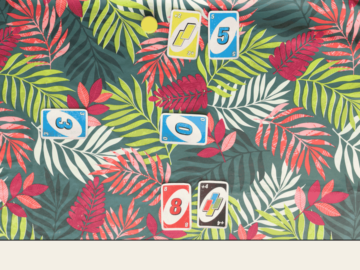
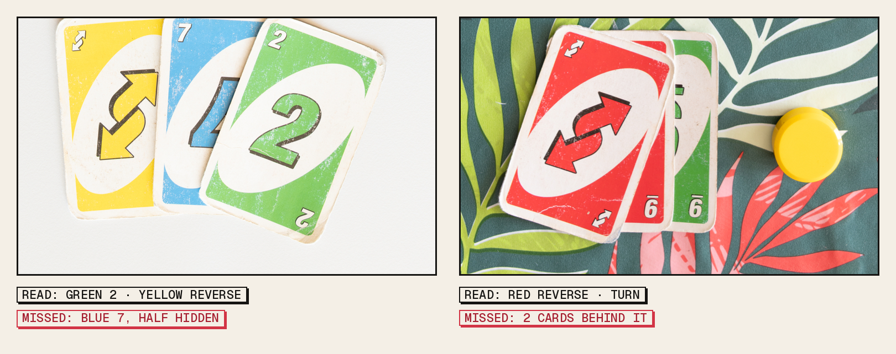
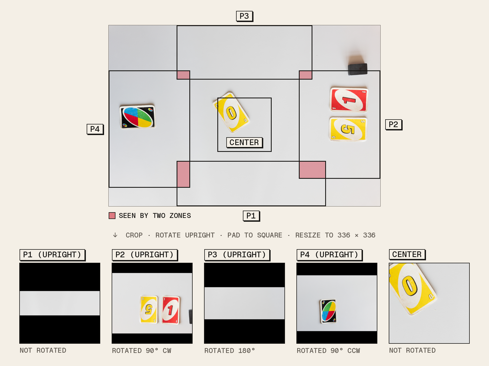
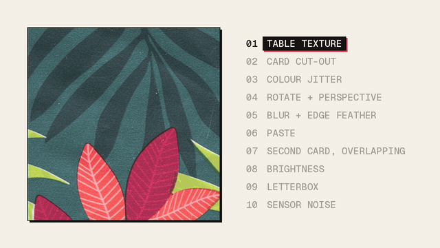
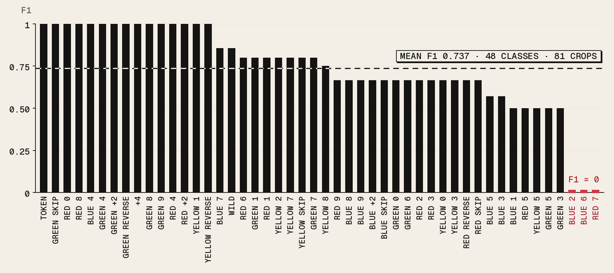
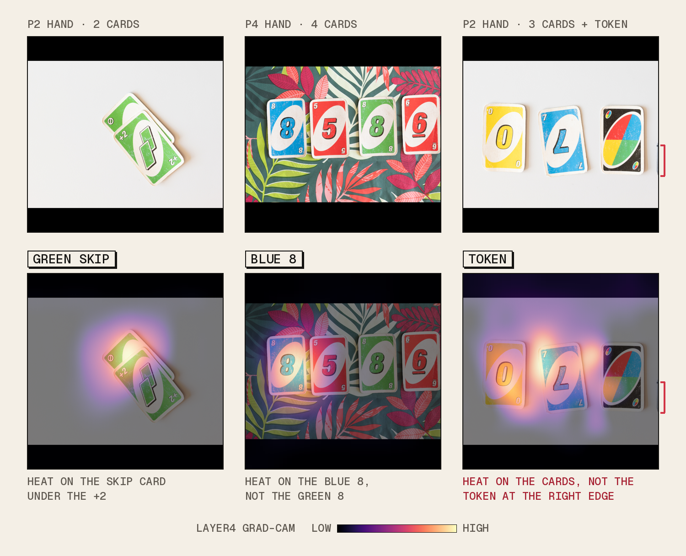

# UNO Vision

Read the state of an UNO table from one overhead photo: every player's hand, the card on
the pile, and whose turn it is.



*The submitted model on a test photo it never saw. It reads 5 of the 6 cards and the turn;
it misses the red 8 in the bottom hand.*

A team project (3 people) for EPFL's *Image Analysis and Pattern Recognition* course,
spring 2026, scored as an in-class Kaggle competition. No pretrained weights: the network
learns from synthetic tables first, then from a few dozen real photos.

## Results

- **75% on the course's Kaggle leaderboard**, scored on the test photos' hidden labels.
- **Mean F1 0.737** over the 48 card classes present in 81 held-out real hand crops
  (`python scripts/evaluate.py`). Counts are scored copy by copy: two red 5s predicted for
  one is one hit and one false positive.
- **Spread-out hands are read well; overlapping fans are not.** Cards that are mostly
  hidden under others are the typical miss: on the held-out crops the model misses a card
  (32 copies) more than twice as often as it invents one (14).
- **11.4 M parameters**, trained from scratch. A photo takes about 0.25 s on a laptop GPU
  (Apple M2) and 0.4 s on its CPU, of which about 0.1 s is decoding the 10 MB JPEG.



## How it works

**1. Five zones.** Each photo is cut on a fixed 20 x 20 grid into the four players' hands
and the center pile. Hands are rotated so their cards are upright, then every crop is padded
to a square with black bars (so round symbols are not squashed into ovals) and resized to
336 x 336.



**2. Count, don't detect.** Real photos only come with lists of cards per hand, not boxes.
So the network does not localise cards: for each of the 56 classes (54 card faces and the
two turn tokens) it predicts how many copies, 0 to 5, a zone holds. Output shape
`(5 zones, 56 classes, 6 counts)`; the argmax is the count.

**3. Model.** A ResNet-18 trunk with CBAM attention on its last feature map (channel
attention, then spatial attention), average pooling, dropout and a linear counting head.
Trained with focal loss, which keeps the many easy "zero copies" targets from swamping the
few cards present.

**4. Synthetic pre-training.** 10,000 images of two overlapping cards on patches of the two
table surfaces, built from 56 hand-cut card images with colour jitter, rotation, perspective,
blur, edge feathering, letterbox bars and sensor noise. Pairs rather than single cards, so
the network learns to recognise a card from its corners when another one covers it.



**5. Fine-tuning on real crops.** The 81 labelled photos give 405 zone crops, split 80/20.
Each training crop is used as is and rotated by 180 degrees with a small rescale (648
images). First only the head is trained (warm-up), then the whole network (polish), each
with early stopping on the validation loss.

**6. Reading the table.** A hand lists its predicted cards. The active player is the one
whose zone holds a token. The center card is the first card counted in the center zone, or,
if none is, the class with the highest "exactly one copy" score, so every photo gets exactly
one center card.





## Quick start

Python 3.9 or newer.

```bash
python -m venv .venv && source .venv/bin/activate
pip install -r requirements.txt
python main.py                      # data/raw/test_images -> submission.csv
```

`main.py` (the course entry point) is a shortcut for `python scripts/predict.py`, which also
takes `--images`, `--weights`, `--out` and `--device`. With the included weights on the
course test set, the output equals `results/submission.csv` (the submitted predictions).

## Data

The course photos and labels are not in this repository. Put them here (`data/` is ignored
by git):

```
data/raw/train_images/   81 labelled photos (L1000770.jpg ...)
data/raw/test_images/    159 test photos
data/raw/train.csv       image_id, center_card, active_player, player_1_cards ... player_4_cards
```

A hand is a `;`-separated list of cards such as `r_1;b_skip;wild`, or `EMPTY`. Card codes are
`{r,g,b,y}_{0-9,draw_2,reverse,skip}`, `wild` and `draw_4`; see `uno_vision/classes.py`.

Everything else is generated by the scripts below. `assets/` holds the hand-cut card images
and table patches the synthetic generator needs (see `assets/README.md`).

## Reproduce the pipeline

```bash
python scripts/prepare_real_data.py      # labels, zone crops, train/val split -> data/processed/
python scripts/generate_synthetic.py     # 10,000 + 2,000 two-card images -> data/synthetic/overlap/ (~4 min)
python scripts/pretrain.py               # synthetic pre-training -> runs/pretrain/best.pth
python scripts/finetune.py --init runs/pretrain/best.pth   # real crops -> runs/finetune/best.pth
python scripts/evaluate.py --weights runs/finetune/best.pth   # F1, error charts, Grad-CAM -> runs/evaluate/
python scripts/predict.py --weights runs/finetune/best.pth --out my_submission.csv
```

- Every script has `--help`. `--device` picks `cpu`, `cuda` or `mps` (default: the best
  available); `--limit N` on the training scripts runs a quick smoke test on N images.
- Pre-training is the long step: about 4 minutes per epoch on an Apple M2 GPU, up to 150
  epochs with early stopping. A fine-tuning epoch takes about 15 s.
- On macOS, `--num-workers 0` is usually as fast as worker processes and avoids their slow
  shutdown.
- `python scripts/evaluate.py` with the included weights gives the 0.737 above;
  `--gradcam-layer layer3` reproduces the Grad-CAM figure of the course report.
- The figures in `docs/figures/` are made by `scripts/figures/` (each script's docstring
  says how; `--font` takes a .ttf, these used Geist Mono).

## Repository layout

```
main.py                   course entry point: test photos -> submission.csv
uno_vision/               the package
  classes.py              the 56 classes, count encoding and decoding
  zones.py                the five zones of a photo
  transforms.py           pad to square, resize, normalise
  model.py                ResNet-18 + CBAM + counting head
  data.py                 dataset for filename,cards CSVs
  losses.py, engine.py    focal loss, training loop and curves
  metrics.py, gradcam.py  counting F1, Grad-CAM
  predict.py              photo -> table state
  synth/                  synthetic two-card images
scripts/                  one script per pipeline step, plus figures/
weights/                  the submitted model (uno_resnet18_cbam.pth, 45.6 MB)
results/submission.csv    the submitted predictions
assets/                   card cut-outs and table patches for the generator
experiments/              earlier approaches, archived (YOLO, grayscale, curriculum...)
docs/figures/             the figures in this README
```

## Notes and limitations

- **The weights predate this layout.** The submitted model was trained with earlier versions
  of the scripts that were not kept; `scripts/pretrain.py` and `scripts/finetune.py` follow
  the recipe of the latest versions. A re-run of that recipe in May reached 0.617 rather
  than 0.737 on the same crops.
- **One fix in the recipe.** The old warm-up meant to train only the head, but its filter
  (`"fc" in name`) also trained CBAM's channel-attention layers. `scripts/finetune.py` trains
  only `fc.*` in the warm-up.
- **The evaluation is optimistic.** The real crops are split by crop, not by photo, so other
  zones of a validation photo can be in the training set.
- **Fixed zones.** The grid assumes the course's camera set-up. Zones overlap at the corners,
  so a card there can be counted in two hands, and a token placed outside every zone is
  missed (the active player then defaults to P1).
- **One token class in the labels.** The real labels mark every active hand with
  `yellow_token`, also on tables where the token is black; the model learns the black one
  from synthetic images only. Which token it sees does not matter for the turn.
- **Grad-CAM layer.** `scripts/evaluate.py` explains the last residual stage (layer4) by
  default; the course report's figure came from layer3.
- The earlier approaches (a YOLO detector, a colour-blind "shape" model, a curriculum by
  hand size, mixed synthetic/real training) are described in
  [`experiments/README.md`](experiments/README.md).
